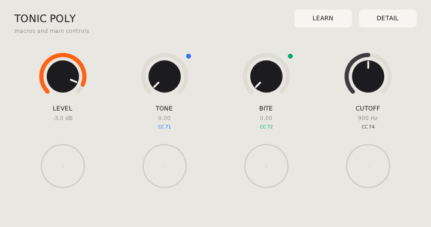
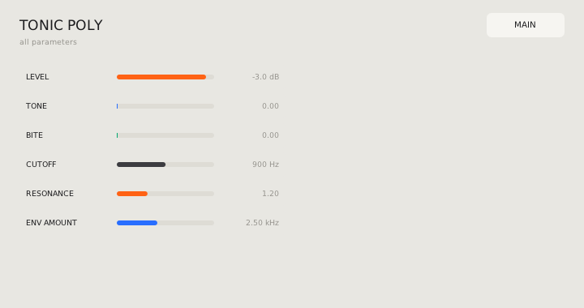
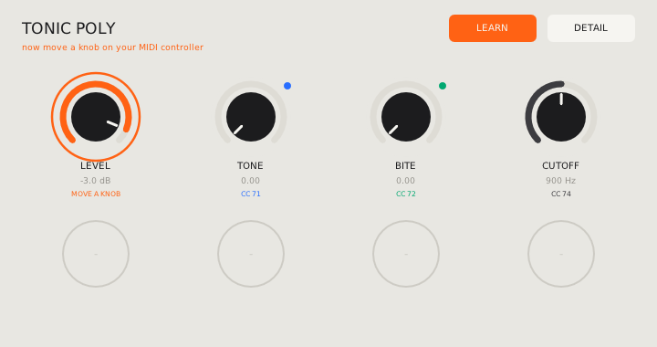

# tonic2

A realtime-safe C++20 synthesis library: the successor core to [Tonic](https://github.com/jtatman/Tonic).
Released into the public domain under the [Unlicense](LICENSE).

```cpp
dsl::Patch p;
auto cutoff = p.param("cutoff", 80, 12000, 500);
auto env    = p.adsr(0.005, 0.25, 0.4, 0.3);
auto osc    = p.saw(p.pitch()) + p.square(p.pitch() * 0.5f, 0.3f) * 0.6f;
p.output(osc * env * 0.35f >> dsl::ladder(cutoff + env * 2500.f, 0.3f) >> dsl::pan(0.f));
auto c = p.compile(48000, 512);   // c.graph, c.layout, c.error
```

**Status: M7 (plugins).** Phase 1 complete: DSP, graph, engine, params/macros, patching syntax, voices,
mixer, and a DPF plugin adapter; see the [design document](https://github.com/jtatman/Tonic/blob/phase1-design/docs/phase1-core-design.md).

For where machine learning could plug in (sound matching, text-to-patch, neural nodes), see the
[AI synthesis survey](docs/ai-synthesis-survey.md).

## DSP kernels (`include/tonic/dsp/`, header-only)

| Header | Contents |
|---|---|
| `oscillator.hpp` | Band-limited sine, saw, square/PWM (minBLEP by default, PolyBLEP optional), triangle (PolyBLAMP) |
| `minblep.hpp` | Minimum-phase band-limited step table, generated at runtime (Blackman sinc at 0.9 Nyquist, real cepstrum) |
| `filters.hpp` | ZDF state-variable filter (LP/BP/HP/notch), ZDF 4-pole ladder with saturation (optional 2x/4x oversampling) |
| `oversampling.hpp` | 2x/4x linear-phase halfband FIR oversampler (63-tap Kaiser, ~80 dB stopband, flat to ~20 kHz) |
| `envelope.hpp` | Analog-style exponential ADSR with exact segment times |
| `smoother.hpp` | One-pole and linear parameter smoothers |
| `noise.hpp` | Deterministic xorshift white noise, pink noise (Kellet) |
| `sequencing.hpp` | Metro (tempo clock), step sequencer, sample & hold, LFNoise (stepped or ramped) |
| `delay.hpp` | Fractional delay line (cubic), stereo feedback delay with ping-pong, bitcrusher |
| `reverb.hpp` | 8-line FDN reverb (Hadamard feedback, RT60 decay, damping, size) |
| `dynamics.hpp` | Compressor / limiter (peak-envelope detector, soft knee, attack/release, sidechain) |
| `math.hpp` | Helpers (Pade tanh, dB, MIDI to Hz, TPT gain) |

Kernel rules: plain structs, no virtual functions, no allocation after `prepare()`, no global state,
no exceptions. They are meant to be ported line-for-line to Rust and Go.

## Build and test

```bash
cmake -S . -B build -DCMAKE_BUILD_TYPE=Release
cmake --build build -j
ctest --test-dir build --output-on-failure
```

Tests check measured behavior (oscillator frequency, aliasing, filter response, envelope timing,
smoother response, block-size independence, stability) and compare against golden renders in
`tests/golden/`. To accept an intentional change: `build/tonic2_golden --update tests/golden`.

## Graph and engine (`include/tonic/graph/`, `include/tonic/engine/`)

```cpp
using namespace tonic;
graph::GraphBuilder b;
auto osc = b.add<graph::OscillatorNode>(dsp::Waveform::Saw, 110.0);
auto lad = b.add<graph::LadderNode>(1, 1200.0, 0.5, 1.5);
auto pan = b.add<graph::PanNode>(0.3f);
b.connect(osc, 0, lad, 0);
b.connect(lad, 0, pan, 0);
b.setOutput(pan);
auto result = b.compile(48000.0, 512);     // control thread; result.error explains failures

engine::Engine e;
e.prepare(48000.0, 512);
e.setGraph(std::move(result.graph));       // control thread, any time (lock-free swap)
e.process(inputs, numIn, outputs, numOut, numFrames);   // audio thread, any block size
e.collectGarbage();                         // control thread, frees replaced graphs
```

- Compilation validates ports and channel counts, removes nodes that don't reach the output,
  rejects cycles, sums multiple connections into one input, broadcasts mono to N channels, and
  reuses buffers (a 50-node chain uses 2 buffers).
- `process()` never allocates, frees, locks or throws. Tests check this with an allocation counter
  while graphs are hot-swapped from another thread; CI also runs ThreadSanitizer and ASan/UBSan.

## Parameters, macros and events (M3)

```cpp
engine::Layout layout;
int cutoff = layout.add({"cutoff", 80.f, 12000.f, 600.f, 0.03f});   // name, min, max, default, smoothing (s)
int bright = layout.add({"brightness", 0.f, 1.f, 0.f, 0.05f});
layout.macros.push_back({bright, {{cutoff, 0.f, 4000.f, 2.f}}});      // macro adds 0..4000 Hz, curve 2
engine.prepare(48000.0, 512, layout);

// Nodes read per-sample values: LadderNode(1, 600, 0.3, 1.5, cutoff), OscillatorNode(saw, FreqSource::note())
engine::Event ev[] = {engine::Event::noteOn(0, 57), engine::Event::param(240, bright, 0.8f)};
engine.process(in, numIn, out, numOut, numFrames, ev, 2);   // events land on their exact frame
engine.setParam(cutoff, 2000.f);                              // UI thread, smoothed, lock-free
```

- Parameters live in the engine, so values survive graph swaps. Changes from events, the UI, and
  macros are smoothed per parameter and delivered to nodes as per-sample buffers.
- Notes drive gate, trigger, pitch and velocity buffers (mono, last-note priority; polyphony is M5).
- `render::renderOffline()` drives an engine with an event list; `render::writeWavFloat()` writes it.
  `build/tonic2_render out.wav` renders a demo phrase (oscillators, ladder, envelope, macro sweep).

## Patching syntax (M4, `include/tonic/dsl/patch.hpp`)

- `Patch` sources: `param`, `macro`, `pitch/gate/trigger/velocity`, `constant`, `sine/saw/square/triangle`,
  `noise`, `adsr`, `mtof`, `dbToGain`, `tanh`, `mix`.
- Arithmetic (`+ - * /`) works between signals and floats; mono signals broadcast to multichannel.
- Effects apply with `>>`: `ladder(cutoff, resonance, drive)`, `lowpass/highpass/bandpass/notch(cutoff, q)`,
  `pan(position)`, `delay(seconds, feedback, mix)`. Every setting accepts a float or a signal, so
  anything can be modulated at audio rate.
- Envelope times and sustain accept numbers or signals: `p.adsr(attackParam, 0.1, sustainMacro, 0.3)`; changing
  sustain while a note is held glides instead of clicking.
- Utilities: `x >> dsl::smooth(seconds)` (Tonic 1 `.smoothed()`), `p.snapToScale(midi, {0,2,3,5,7,10}, root)`,
  `p.select(index, {a, b, c})` (Tonic 1 ControlSwitcher).
- Ported Tonic 1 units: `pinkNoise`, `lfNoise(rate)`, `metro(bpm, division)`, `stepper(trigger, {values})`,
  `sampleHold(trigger, min, max)`; effects `modDelay(time, feedback, mix, pingPong)`, `crush(bits, rate)`,
  `reverb(size, decay, damping, mix)`, `compressor(...)`, `limiter(ceiling)`, `ducker(sidechain)`.
- Mistakes (channel mismatch, signals from another patch, missing output) are reported by `compile()`.
- `>>` binds looser than `+` and `*`: `a + b >> fx` filters the sum; prefer `(a + b) >> fx`.

`examples/demo_synths.hpp` has a mono synth and ports of Tonic 1's SineSum, FMDrone and FilteredNoise
demos (differences from the originals are commented). Render one with `build/tonic2_render fmdrone out.wav`.

## Voices (M5)

```cpp
auto cutoff = p.param("cutoff", 100, 8000, 900);
auto synth = p.voices({8, dsl::VoiceMode::Poly, 2, 9.f}, [&](dsl::Patch& v) {   // 8 voices, 2-voice unison, +/-9 cents
  auto env = v.adsr(0.01, 0.4, 0.5, 0.6);
  v.output(v.saw(v.pitch()) * env * v.velocity() >> dsl::lowpass(v.use(cutoff) + env * 2500.f));
});
p.output(synth >> dsl::pan(0.f) >> dsl::delay(0.33, 0.35f, 0.25f));   // shared effects after the voices
```

- Modes: `Poly`, `Mono` (last-note priority, retrigger), `Legato` (no retrigger while notes overlap);
  `unison` voices per note with symmetric detune.
- Stealing takes the oldest released voice, then the oldest held one. Released voices are freed once
  silent (below -100 dBFS for a block) and cost nothing while free.
- Per-voice signals: `pitch`, `gate`, `trigger`, `velocity`, and per-note expressions `pressure`,
  `timbre` and pitch bend (`Event::expression`, as in CLAP note expressions / MPE).
- Glide and pitch wheel: `VoiceConfig::glideSeconds` (one-pole portamento on the note pitch; voices starting
  from silence jump) and `bendRange` (pitch wheel, `Event::pitchWheel`, -1..1). Bends apply instantly on top
  of the glide. The plugin adapter forwards MIDI pitch-wheel messages.
- Routing: `VoiceConfig::channel` (MIDI channel 0..15, -1 = any) and `lowKey`/`highKey` let several voice
  nodes in one patch play different parts or a keyboard split; events without a channel reach every node.
  The DPF adapter keeps the MIDI channel of incoming notes.
- Outer parameters are read inside a voice with `v.use(param)`; declaring parameters inside a voice is
  an error. The build function runs once per voice immediately, so it may capture locals by reference.
- Benchmark (`voice_tests`): a 16-voice saw+square+ladder synth runs at ~55x realtime on one core
  (WSL, recent x86) and ~37x on a 2019-era Intel Mac.

## Mixer and FX matrix (M6, `include/tonic/dsl/mixer.hpp`)

```cpp
dsl::Mixer mix(p);
auto echo = mix.fxReturn([](dsl::Signal in) { return in >> dsl::delay(0.375, 0.45f, 1.f); });
auto keys = mix.group({.gainDb = -1.f});
auto pad  = mix.strip(padSig,  {.gainDb = -3.f, .pan = -0.25f}, &keys);
auto lead = mix.strip(leadSig, {.gainDb = leadGain, .solo = leadSolo});
mix.send(pad, echo, space * 0.6f);              // post-fader; pass true for pre-fader
p.output(mix.master({.gainDb = -1.f}));
float peak = lead.meter->readAndReset();         // any thread
```

- Strips: gain (dB), pan with constant-power (-3 dB), linear (-6 dB) or compromise (-4.5 dB) law
  (stereo inputs use balance), mute with a 5 ms fade, solo, peak meter, pre/post-fader sends.
- Groups sum strips and are soloable; FX returns are solo-safe; the master has its own strip and meter.
- `dsl::fxMatrix(in, slots, routes)`: effect slots wired by a feed-forward routing matrix
  (`{kFxIn, 0}, {0, 1}, {1, kFxOut}` = serial; several routes to one slot are summed). Any route gain can
  be a parameter, so serial/parallel morphs crossfade without clicks. Backward routes are rejected.
- Every setting is a Value, so parameters, macros and modulation all work.

## Plugins (M7, `adapters/dpf/`)

Any patch becomes a VST3 / CLAP / LV2 plugin through [DPF](https://github.com/DISTRHO/DPF) (ISC license,
no Steinberg SDK needed). The example plugin wraps the poly demo:

```bash
git submodule update --init third_party/DPF
cmake -S . -B build -DCMAKE_BUILD_TYPE=Release -DTONIC2_BUILD_DPF=ON
cmake --build build -j          # build/bin/tonic2_poly.{vst3,clap,lv2}
ctest --test-dir build          # includes a minimal CLAP host that loads the plugin and renders a chord
```

On Windows with Visual Studio 2022:

```powershell
powershell -ExecutionPolicy Bypass -File tools/build_windows.ps1   # build-win/bin/tonic2_poly.vst3 etc. + ctest
powershell -ExecutionPolicy Bypass -File tools/host_render.ps1     # render a song through the VST3 in a real host
```

`host_render.ps1` drives the songengine Go VST3 host offline (`-plugin role=path.vst3` on every role,
including kick, hats and fx), checks from songengine's routing diagram that every part is played by the
plugin under test, then checks the output level. It accepts `-Plugin` for any other VST3.

- `TonicDpfPlugin` (generic): engine parameters become host parameters; MIDI notes become
  sample-accurate engine events; the patch is compiled in `activate()` at the host sample rate.
- New plugin = a `DistrhoPluginInfo.h` + a one-line `createPlugin()` passing a patch build function.
- No custom UI yet (hosts show generic controls). CI builds all three formats on Linux, Windows and
  macOS, runs the CLAP host test, and uploads the plugins as artifacts.

## MIDI CC, MIDI learn and automation timing

```cpp
p.midiCc(74, brightness);        // patch-level binding: CC 0..127 sweeps the parameter's range
engine.mapCc(1, cutoff.id);      // control thread, any time
engine.learnCc(macro.id);        // MIDI learn: the next CC that arrives is bound to `macro`
```

- One parameter per CC; bind a macro to move several parameters from one knob.
- CC events are sample-accurate (engine events with frame offsets; the plugin adapter forwards them).
- Host automation through DPF is block-accurate: DPF applies parameter changes at the start of the
  host block, and the engine smooths them. `tonic2_probe` (a test plugin whose output equals its parameter)
  checks both behaviours in the CLAP host test.

## Plugin UI (`adapters/dpf/TonicDpfUI.hpp`, `include/tonic/ui/surface.hpp`)

A minimal control surface instead of a panel full of knobs:

| Main | Detail |
|---|---|
|  |  |

**MIDI learn:** click LEARN, click a control, move a knob on your controller; right-click a control in learn mode to
clear its CC. Bindings are saved with the project (plugin state `ccmap`, verified through a CLAP state round trip
in the host test). When the UI runs in the plugin's process it shows learned bindings live.



- **Main:** up to 8 knobs, matching an 8-knob MIDI controller. Parameters marked `UiPlace::Main` come first,
  then macros (marked with a dot), then CC-bound parameters (with a `CC nn` tag). Empty slots stay visible.
- **Detail:** every visible parameter as a slider.
- Drag knobs vertically (Shift = fine), scroll to nudge, double-click or right-click to reset.
- Parameters carry a unit, log scaling and UI placement (`engine::ParamSpec::unit/log/ui`); the
  selection and formatting logic lives in `tonic/ui/surface.hpp`, independent of any GUI toolkit.
- The UI is generic: a plugin's `createUI()` passes the same patch build function as its DSP side.
- Build without the UI (headless Linux) with `-DTONIC2_DPF_UI=OFF`. Screenshots on Windows:
  `build-win/.../tonic2_uishot.exe build-win/bin/tonic2_poly-vst2.dll out.bmp` (`TONIC2_UI_PAGE=detail` for
  the detail page).

## Standalone player (`adapters/standalone/play.cpp`)

Play any demo patch on an audio device with live MIDI input, no plugin host needed:

```powershell
build-win\adapters\standalone\Release\tonic2_play.exe --list              # audio outputs and MIDI inputs
build-win\adapters\standalone\Release\tonic2_play.exe --demo poly --midi 0
build-win\adapters\standalone\Release\tonic2_play.exe --demo mono --audio 0 --midi all
build-win\adapters\standalone\Release\tonic2_play.exe --null --notes --seconds 1   # silent self-test
```

- Audio through [miniaudio](https://github.com/mackron/miniaudio) (public domain / MIT-0): WASAPI, CoreAudio,
  ALSA/PulseAudio, JACK. MIDI through RtMidi (bundled with DPF): WinMM, CoreMIDI, ALSA. Notes, CC (with the
  patch's CC bindings), pitch wheel and channels are passed to the engine via a lock-free queue.
- Build with `-DTONIC2_BUILD_STANDALONE=ON` (on by default in `tools/build_windows.ps1`).
- Verified end to end on Windows: songengine sent a song's MIDI into a loopMIDI port and `tonic2_play` rendered it.
- On macOS and Linux the DPF `jack` target also builds `tonic2_poly` as a standalone app with the plugin UI
  (JACK or native audio). On Windows/MSVC DPF's native fallback is unavailable, so use `tonic2_play` there.
- ASIO is not enabled: Steinberg's ASIO SDK is GPLv3 or proprietary, which would change the license of the binary.

## Sound matching (`include/tonic/analysis/`, `tools/match.cpp`)

Finds parameter values that make a patch sound like a target recording, with no machine-learning
dependencies (step 1 of the [AI synthesis survey](docs/ai-synthesis-survey.md)).

- `spectral.hpp`: FFT and a multi-resolution STFT distance (spectral convergence plus log-magnitude L1
  at FFT sizes 256, 1024 and 4096), the loss used in DDSP and most sound-matching papers.
- `cmaes.hpp`: full-covariance CMA-ES over the unit box, with seeded, reproducible randomness and parallel evaluation.
- `match.hpp`: renders the patch offline with its note script and searches the chosen parameters
  through their normalised (log where declared) ranges. Each candidate gets a fresh engine.

```bash
tonic2_render poly target.wav    # or any float WAV written by a tonic2 tool
tonic2_match --demo poly --target target.wav --params "cutoff,resonance,env amount,level" --json best.json --out best.wav
tonic2_match --demo poly --truth "cutoff=2000,resonance=3,env amount=800,level=-9" --params "cutoff,resonance,env amount,level"
```

The last command recovers all four values (1.99 kHz, 2.85, 797 Hz, -8.9 dB) in 400 renders, about
40 s on 6 threads. `tests/match_tests.cpp` checks the FFT, the distance, CMA-ES on sphere, corner and
Rosenbrock problems, determinism, and recovery of the mono demo's cutoff and resonance.

## Text-to-patch agent (`tools/patch_agent/`)

Describe a sound in words and an LLM programs a demo patch to match (step 2 of the
[AI synthesis survey](docs/ai-synthesis-survey.md)). It runs as a loop:

1. `tonic2_render --layout <demo>` prints the demo's description and parameters (ranges, units, which
   parameters each macro drives) as JSON.
2. The model proposes a value for every parameter. A JSON schema built from the layout constrains the
   reply, and out-of-range values are clamped and reported back.
3. `tonic2_render <demo> out.wav --set "name=value,..." --features` renders the values and measures
   level, spectral centroid and rolloff, flatness, band balance, attack, sustain and tail
   (`include/tonic/analysis/features.hpp`). The model can't hear, so these numbers are its feedback.
4. The model revises or reports done, for up to `--rounds` rounds.

The model sits behind a small interface (`backends.py`: `start(system, schema)`, `ask(text) -> dict`):

| `--backend` | Runs on | Needs |
|-|-|-|
| `anthropic` | Claude Opus 5.5 via the Messages API (structured outputs, refusal fallback) | API credits; `pip install -r requirements.txt`; `ANTHROPIC_API_KEY` or `ant auth login` |
| `claude-code` | Claude via the Claude Code CLI in headless mode (`claude -p --json-schema`, no tools) | the `claude` CLI, logged in; billed to its subscription |
| `openai` | any OpenAI-style `/chat/completions` server: Ollama (default URL), llama.cpp, LM Studio, vLLM | a local server and model; nothing else |

```bash
python tools/patch_agent/patch_agent.py "warm evolving pad with a slow attack" --demo poly --backend openai --model qwen3:4b --out pad
python tools/patch_agent/patch_agent.py "squelchy acid bass" --demo mono --backend claude-code --effort high
# -> PREFIX.json ({"params": {...}} like tonic2_match), PREFIX.wav, PREFIX_rounds/ (every render)
```

Local thinking models: the `openai` backend sends `reasoning_effort: "none"` by default. `qwen3:4b`
took over 10 minutes per reply with thinking on and about 30 s per round without it
(`--local-reasoning` to change, `omit` for servers that reject the field). A 4B model follows the
schema but reasons poorly about sound; the Claude backends are expected to do much better.
`test_patch_agent.py` covers all three backends with fakes (scripted SDK client, fake CLI, local HTTP
server) and runs the loop against real `tonic2_render` output, so ctest needs neither network nor SDK.
